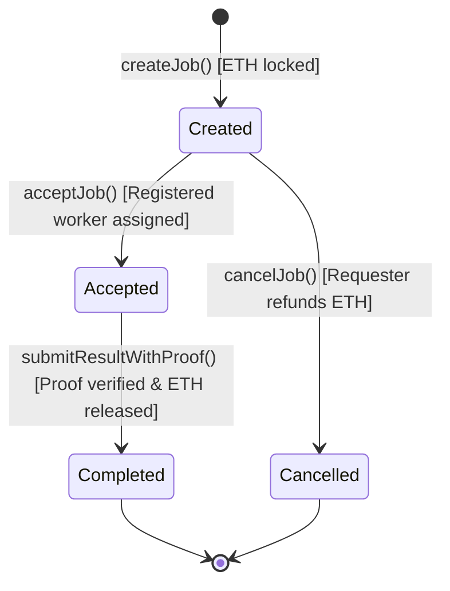

# End-to-End Workflow & Smart Contract Specification

This document specifies the architecture, state transitions, security model, and API for the **Decentralized Compute Marketplace** smart contract pipeline.

---

## High-Level Pipeline

```text
Requester                Smart Contract (Escrow)                Worker                Verifier (RISC Zero)
    |                              |                              |                            |
    |  1. createJob(imageId, data) |                              |                            |
    |     [Escrows ETH reward]     |                              |                            |
    |----------------------------->|                              |                            |
    |                              |                              |                            |
    |                              |  2. registerWorker()         |                            |
    |                              |<-----------------------------|                            |
    |                              |                              |                            |
    |                              |  3. acceptJob(jobId)         |                            |
    |                              |<-----------------------------|                            |
    |                              |                              |                            |
    |                              |                       [Executes Workload]                 |
    |                              |                       [Generates Proof]                   |
    |                              |                              |                            |
    |                              |  4. submitResultWithProof()  |                            |
    |                              |<-----------------------------|                            |
    |                              |                                                           |
    |                              |  5. verify(imageId, journal, seal)                        |
    |                              |---------------------------------------------------------->|
    |                              |<----------------------------------------------------------|
    |                              |                     [Proof Verified]                      |
    |                              |                                                           |
    |                              |  6. Release Escrow Payout                                 |
    |                              |----------------------------->|                            |
    |                              |                              |                            |
```

---

## Job State Machine



### State Descriptions

| Status      | Code | Description                                                      | Next Allowed States         |
| ----------- | ---- | ---------------------------------------------------------------- | --------------------------- |
| `None`      | `0`  | Uninitialized / Non-existent job                                 | `Created` (via `createJob`) |
| `Created`   | `1`  | Job created by requester; reward locked in contract escrow       | `Accepted` or `Cancelled`   |
| `Accepted`  | `2`  | Job claimed by a registered worker; computation in progress      | `Completed`                 |
| `Completed` | `3`  | Result & proof submitted, verified, and payout released          | Final state                 |
| `Cancelled` | `4`  | Cancelled by requester before worker acceptance; reward refunded | Final state                 |

---

## Tiger-Style Principles & Security Invariants

1. **Explicit Custom Errors**: Zero generic string reverts (`revert("...")`). All failure paths revert with typed custom errors with descriptive arguments for minimal gas overhead and clear debugging.
2. **Checks-Effects-Interactions (CEI)**: State transitions (`job.status = JobStatus.Completed`) occur before sending ETH to prevent reentrancy and duplicate claims.
3. **Reentrancy Protection**: Non-reentrant mutex locks protect state-modifying payouts and refunds.
4. **Strict Authorization**:
   - Only registered workers can accept jobs.
   - Requester cannot accept their own job.
   - Only the assigned worker can submit results for an accepted job.
   - Only the requester can cancel a job (and only while in `Created` status).
5. **Atomic Escrow & Payout**: Funds are held safely in the contract balance and can only be released upon valid cryptographic verification or explicit cancellation refund.

---

## Smart Contract API (`ComputeMarketplace.sol`)

### Core Functions

- `registerWorker()`: Registers `msg.sender` as an authorized compute worker.
- `unregisterWorker()`: Unregisters `msg.sender`.
- `createJob(bytes32 imageId, bytes calldata inputData) payable returns (uint256 jobId)`: Creates a new job with escrowed ETH (`msg.value > 0`).
- `acceptJob(uint256 jobId)`: Assigns registered worker to the job and updates status to `Accepted`.
- `submitResultWithProof(uint256 jobId, bytes calldata result, bytes calldata proof)`: Verifies computation proof via `IRiscZeroVerifier` and transfers reward to worker.
- `cancelJob(uint256 jobId)`: Refunds escrow to requester if job is still in `Created` status.
- `setVerifier(address newVerifier)`: Contract owner updates the verifier contract address.
- `getJob(uint256 jobId) returns (Job memory)`: Returns all metadata, status, addresses, and payload of a job.

### Events

- `event WorkerRegistered(address indexed worker)`
- `event WorkerUnregistered(address indexed worker)`
- `event JobCreated(uint256 indexed jobId, address indexed requester, uint256 reward, bytes32 indexed imageId)`
- `event JobAccepted(uint256 indexed jobId, address indexed worker)`
- `event JobCompleted(uint256 indexed jobId, address indexed worker, uint256 reward, bytes result)`
- `event JobCancelled(uint256 indexed jobId, address indexed requester, uint256 refundAmount)`
- `event VerifierUpdated(address indexed previousVerifier, address indexed newVerifier)`
- `event OwnershipTransferred(address indexed previousOwner, address indexed newOwner)`

---

## Verification Boundary Integration (`IRiscZeroVerifier.sol`)

The marketplace interacts with the proof verifier through a standardized interface:

```solidity
interface IRiscZeroVerifier {
  function verify(
    bytes32 imageId,
    bytes calldata journal,
    bytes calldata seal
  ) external view returns (bool valid);
}
```

When the RISC Zero branch is ready with the on-chain verifier deployment, the contract owner simply calls `setVerifier(riscZeroVerifierAddress)`.
